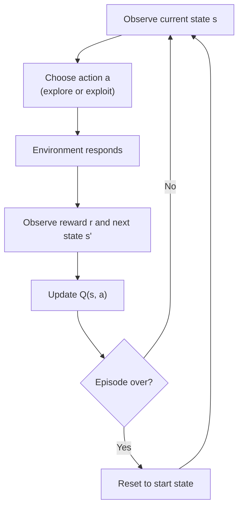

# Q-Learning: Learning to Make Better Decisions

Q-learning is a way for an agent to learn **which action to take in a situation** by trying actions and receiving feedback from its environment.

Instead of being given a complete set of instructions, the agent learns from experience:

1. Observe the current situation.
2. Choose an action.
3. Receive a reward and observe the next situation.
4. Update its estimate of how useful that action was.
5. Repeat until its decisions improve.

This project demonstrates the idea with a small 5 × 5 grid-world. The agent starts in the top-left cell and learns to reach the bottom-right goal.

## A simple grid-world

In [`main.py`](./main.py), the agent can move **up**, **right**, **down**, or **left**. It cannot leave the grid; an attempted move beyond an edge leaves it in the same row or column at the boundary.

In this example:

- The start state is `(0, 0)`.
- The goal state is `(4, 4)`.
- Reaching the goal gives a reward of `+10`.
- Each other move gives a reward of `-0.1`, encouraging shorter routes.
- An episode ends when the agent reaches the goal or takes 200 steps.

## The key idea: a Q-value

A **state** describes where the agent is. Here, a state is a grid coordinate such as `(2, 3)`.

An **action** is a choice available in that state, such as `up` or `right`.

A **Q-value**, written `Q(state, action)`, estimates how much total reward the agent can expect if it takes that action in that state and then continues making good choices.

For example:

```text
Q((2, 3), right) = estimated usefulness of moving right from (2, 3)
```

The agent stores these estimates in a **Q-table**: one row for each state and one value for each possible action. At first, the estimates are zero because the agent has not learned which moves are useful.

When it needs to choose a move, the agent can select the action with the highest Q-value. As learning progresses, actions that tend to lead toward the goal receive better estimates.

## How learning works

After taking action `a` in state `s`, the agent observes:

- the immediate reward `r`;
- the next state `s'`;
- whether the next state is terminal (the episode is over).

The interaction repeats as a feedback loop:



It then updates the old estimate using:

```text
Q(s, a) ← Q(s, a) + α [r + γ × best_future_value − Q(s, a)]
```

For a non-terminal next state:

```text
best_future_value = max over actions a' of Q(s', a')
```

For a terminal next state, there is no future reward, so `best_future_value` is `0`.

In words:

> Move the old estimate a little toward the reward just received plus the best estimated value available afterward.

The difference between that new target and the old estimate is called the **temporal-difference error**. The update lets the agent learn from both immediate feedback and its current expectations about the future.

## The learning parameters

The example calls the learning function with `alpha=0.1`, `gamma=0.9`, `epsilon=0.3`, and `500` episodes.

| Parameter | Meaning | In this example |
| --- | --- | --- |
| `alpha` (learning rate) | How much each new experience changes an existing Q-value. A smaller value makes updates gentler. | `0.1` |
| `gamma` (discount factor) | How much future rewards matter compared with immediate rewards. Values closer to `1` make the agent consider rewards farther ahead. | `0.9` |
| `epsilon` (exploration rate) | How often the agent tries a random action instead of choosing its current best-known action. | `0.3` |
| `episodes` | How many attempts the agent makes, starting from the initial state each time. | `500` |

### Exploration and exploitation

The agent faces a choice:

- **Exploration:** try a move it does not yet know much about.
- **Exploitation:** choose the move that currently has the highest estimated value.

If it only exploits, it may settle on a poor choice before discovering a better route. If it only explores, it never makes consistent use of what it has learned. Epsilon-greedy selection balances the two: with probability `epsilon`, choose randomly; otherwise, choose the action with the highest Q-value.

## What “model-free” means

Q-learning is **model-free**: the agent does not need a map of all possible outcomes or a formula describing how the environment works. It learns from transitions it experiences—state, action, reward, next state.

It is also commonly described as **off-policy**. It learns the value of the best estimated next action, even when the agent sometimes takes a random action to explore.

## Following the code

The main parts of the example are:

- `create_q_table()` creates an initially zero-valued entry for each grid position and action.
- `q_learn(...)` runs the training episodes, chooses actions, observes rewards, and updates Q-values.
- The final print statement displays the learned values for the starting state `(0, 0)`, in the same order as `ACTIONS`: up, right, down, left.

Because action selection includes randomness, the printed values can differ between runs. They are estimates learned from the sampled experience—not guaranteed values or a promise that every run finds the same route.

Run the example from the repository root with:

```powershell
python .\0.Q_Learning\main.py
```

## What this example teaches—and what it leaves out

This compact example makes the Q-table and update rule visible. It has a small, discrete state space, a fixed goal, deterministic movement, and no obstacles.

Tabular Q-learning becomes impractical when states or actions are continuous or extremely numerous: the table can grow too large, and many entries may never be visited. Larger problems often use function approximators, such as neural networks, to estimate action values. Those methods introduce additional challenges and are not the same as simply storing a table.

## In one sentence

**Q-learning improves decisions by repeatedly comparing what an action was expected to earn with the reward and future opportunity that actually followed.**

## Contact

- GitHub: [@iam-dev-Adarsh](https://github.com/iam-dev-Adarsh)
- Email: [iamvoid03@gmail.com](mailto:iamvoid03@gmail.com)