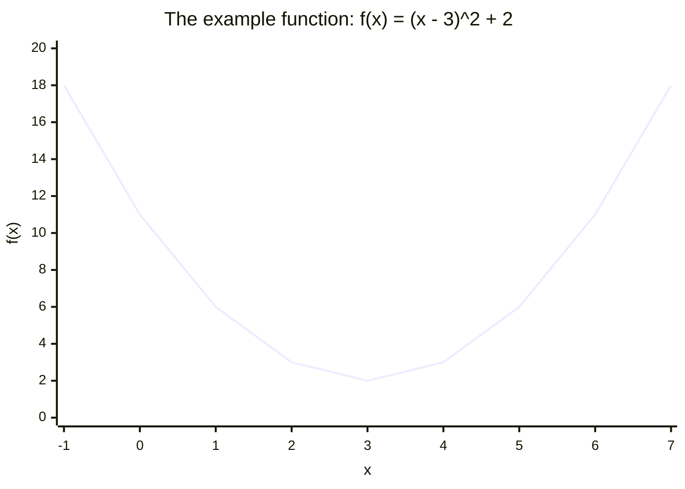
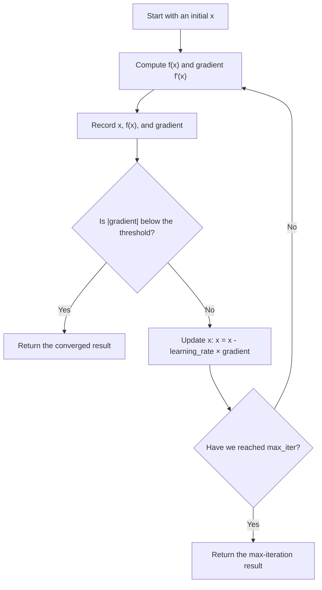

# Gradient Descent: Finding the Bottom of a Curve

Gradient descent is a simple, widely used way to find an input that makes a function as small as possible.

Imagine standing somewhere on a smooth hill in thick fog. You cannot see the whole landscape, but you can feel which way the ground slopes beneath your feet. Take a small step downhill, check the slope again, and repeat. Gradient descent turns that idea into an algorithm.

This project applies the method to a quadratic function using plain Python. The implementation is in [`main.py`](./main.py).

## The function in this example

The code defines the quadratic function

```text
f(x) = ax² + bx + c
```

Its test uses `a = 1`, `b = -6`, and `c = 11`, so:

```text
f(x) = x² - 6x + 11 = (x - 3)² + 2
```

This is a bowl-shaped curve. Its lowest point is at `x = 3`, where `f(x) = 2`.



The chart shows the objective—the value we want to minimize—as `x` changes. Gradient descent does not need to draw this chart or know the location of the minimum in advance. It uses the slope at its current position.

## The gradient tells us which way is downhill

For

```text
f(x) = ax² + bx + c
```

the derivative (gradient in this one-dimensional example) is

```text
f'(x) = 2ax + b
```

The gradient describes the local slope:

- If `f'(x)` is **negative**, the function slopes down as `x` moves to the right.
- If `f'(x)` is **positive**, the function slopes down as `x` moves to the left.
- If `f'(x)` is **near zero**, the slope is nearly flat.

For the example, `f'(x) = 2x - 6`. At the starting point `x = 0`, the gradient is `-6`, so moving to the right should decrease the function.

## The update: take a step against the slope

Gradient descent updates its current position using

```text
x_next = x - learning_rate × f'(x)
```

The minus sign is important: it moves opposite the slope, toward lower function values.

With the example's learning rate of `0.1`, the first step is:

```text
x_next = 0 - 0.1 × (-6) = 0.6
```

The position moves from `0` toward the minimum at `3`. At `x = 0`, the function value is `11`; after the step, at `x = 0.6`, it is `7.76`. The algorithm repeats this process, taking progressively smaller steps as the slope approaches zero.



## Choosing the learning rate

The `lr` parameter is the **learning rate**: it controls the size of each step.

- If it is too large, the algorithm can jump past the minimum, oscillate, or diverge.
- If it is too small, it can move toward the minimum very slowly.

For this one-dimensional quadratic with `a > 0`, a constant learning rate converges when

```text
0 < lr < 1 / a
```

This is a condition for this specific quadratic, not a universal rule for every optimization problem. The code's example uses `a = 1` and `lr = 0.1`, which satisfies it.

## When does the algorithm stop?

The implementation stops when either:

1. The absolute gradient is smaller than `threshold`, indicating that the slope is nearly flat; or
2. It has performed `max_iter` iterations.

The gradient threshold is different from a threshold on the function value. A function can have a large value but a zero gradient, or a small value but a nonzero gradient. The gradient measures slope; `f(x)` measures the objective.

## How this maps to the code

| Code | Purpose |
| --- | --- |
| `quadratic_function(x, a, b, c)` | Calculates the objective value `f(x)`. |
| `quadratic_gradient(x, a, b)` | Calculates the slope `f'(x) = 2ax + b`. |
| `gradient_descent(...)` | Repeatedly evaluates the function and gradient, checks convergence, and updates `x`. |
| `history` | Stores the iteration number, current `x`, function value, and gradient for inspection. |

The example starts at `x = 0`, uses `lr = 0.1`, stops when the gradient magnitude is below `1e-6`, and allows up to `1000` iterations. For its chosen quadratic, it should approach `x = 3` and a minimum function value of `2`.

## Important assumptions and limitations

- The example is one-dimensional and uses an exact derivative. Other functions may need numerical differentiation or automatic differentiation.
- For a quadratic with `a > 0`, the curve has a minimum. If `a < 0`, it opens downward and has no finite minimum; if `a = 0`, it is linear or constant.
- A small gradient indicates a stationary point. It does not by itself prove that the point is a minimum for every possible function.
- The function's constant term `c` shifts every function value by the same amount, but does not change its gradient or the location of its minimum.

## In one sentence

**Gradient descent repeatedly measures the slope at its current position and takes a controlled step in the direction that lowers the function.**

## Contact

- GitHub: [@iam-dev-Adarsh](https://github.com/iam-dev-Adarsh)
- Email: [iamvoid03@gmail.com](mailto:iamvoid03@gmail.com)