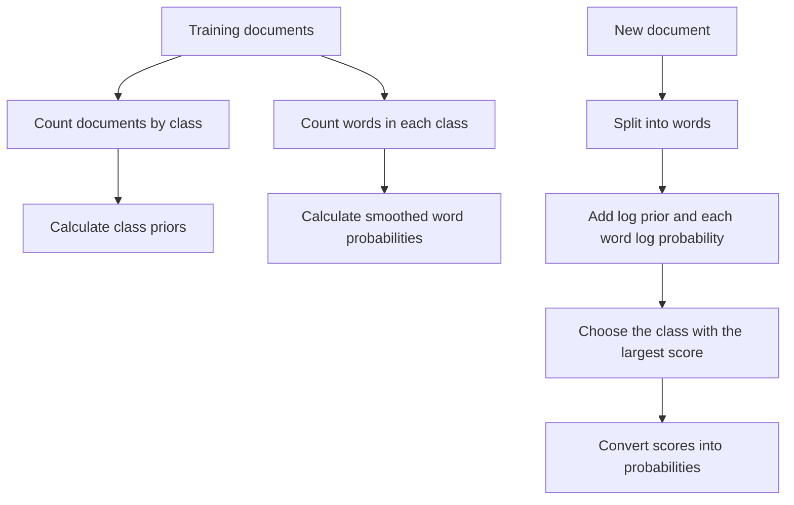

# Naive Bayes: Probabilistic Text Classification

A **Naive Bayes classifier** assigns a class to a text example by comparing probabilities. For a document containing words \(w_1, w_2, ..., w_n\), it estimates the posterior probability of every class and chooses the class with the largest value:

```text
class = argmax P(class) × P(w₁ | class) × P(w₂ | class) × ... × P(wₙ | class)
```

The method is called **naive** because it assumes that the words contribute independently, even though words in real language are often related. That simplification makes training fast and often works surprisingly well for text tasks.

This project implements both a hand-written multinomial-style Naive Bayes classifier and scikit-learn's `MultinomialNB` on a small toy document collection. The implementation is in [`main.py`](./main.py).

## The example: classifying short messages

The training data contains 10 short documents divided into two classes:

| Label | Meaning | Example |
| ---: | --- | --- |
| `1` | Spam | `"limited fee trail register now"` |
| `0` | Ham | `"download report document view attachment"` |

The script also evaluates four test messages. One of the test labels is deliberately or potentially inconsistent with the word patterns:

- `"maximus decimus meridius"` is labeled `0` (ham), even though `"maximus"` and `"decimus"` occur in a spam document.
- `"Baby stand ready for arrival"` contains the known spam word `"Baby"` and an unknown word `"arrival"`.

The small training set makes individual words highly influential.

## Bayes' rule

For a class \(c\) and a document \(d\), Bayes' rule gives:

```text
P(c | d) = P(d | c) × P(c) / P(d)
```

- **Prior, \(P(c)\):** how common the class is in the training data.
- **Likelihood, \(P(d|c)\):** how likely the document looks if it belongs to the class.
- **Evidence, \(P(d)\):** a normalizing value shared by all candidate classes.

Because the evidence is the same for every class, the classifier does not need to calculate it when choosing the best class.

## Where the "naive" independence assumption comes in

The implementation estimates a document's likelihood as the product of individual word likelihoods:

```text
P(document | class) ≈ P(word₁ | class) × P(word₂ | class) × ...
```

The repeated words in `"shaka shaka boom boom"` contribute repeatedly, so each occurrence of a word increases or decreases the class score again.



## Priors

The class prior is the fraction of training documents belonging to that class:

```text
P(c) = number of documents in class c / total number of documents
```

In this dataset, both classes have five documents, so both priors are:

```text
P(spam) = 5 / 10 = 0.5
P(ham)  = 5 / 10 = 0.5
```

With balanced priors, word evidence determines most of the predictions.

## Word likelihoods

The hand-written implementation uses Laplace (add-one) smoothing:

```text
P(w | c) = (count(w, c) + 1) / (total words in c + vocabulary size)
```

- `count(w, c)` is the number of times word `w` appears among documents of class `c`.
- `total words in c` is the total word count for that class.
- The vocabulary size is the number of distinct words found across the entire training set.

The same smoothing is used by scikit-learn's `MultinomialNB(alpha=1.0)`, making the two implementations conceptually comparable.

## Unknown words

A word not present in the training vocabulary is not assigned a normal word probability. The hand-written implementation gives it the special `<UNK>` probability:

```text
P(<UNK> | c) = 1 / (total words in c + vocabulary size)
```

The unknown word therefore receives the same Laplace-smoothed probability as an unseen vocabulary word. In the test message `"Baby stand ready for arrival"`, `"arrival"` is unknown and `"Baby"` is known.

The scikit-learn `CountVectorizer` handles unseen words differently: it builds a fixed training vocabulary and ignores test words outside that vocabulary.

## Why the code uses log probabilities

Each product of probabilities is usually much smaller than 1. Multiplying many such values can underflow to zero in a computer. The implementation avoids this by summing logarithms:

```text
log score(c) = log(P(c)) + sum(log(P(w | c)))
```

Logarithms preserve ordering:

```text
If log score(c₁) > log score(c₂),
then P(c₁) > P(c₂).
```

This also makes the calculation numerically stable.

## Converting scores into probabilities

The raw log scores may look unfamiliar because their values can be negative and unnormalized. The implementation converts them with the softmax transformation:

```text
P(c) = exp(log score(c) - max log score) /
       sum(exp(log score(k) - max log score) for all classes k)
```

Subtracting the maximum log score before exponentiation prevents overflow. The resulting probabilities add to 1:

```text
P(spam) + P(ham) = 1
```

These probabilities are normalized confidence estimates, but they are not necessarily calibrated probabilities for real-world deployment.

## What the hand-written code does

| Code | Purpose |
| --- | --- |
| `NaivBayes.fit(...)` | Learns class priors and word likelihoods from labeled documents. |
| `self.classes` | Stores the distinct training labels. |
| `self.vocab` | Stores the distinct words found in training. |
| `self.log_prior` | Stores `log(P(class))` for every class. |
| `self.log_lik` | Stores `log(P(word | class))` for every class and vocabulary word. |
| `'<UNK>'` | Represents a word not found in the training vocabulary. |
| `NaivBayes.predict(...)` | Splits a document into words, sums log scores, and returns the winning class. |
| `probs` | Normalizes class scores into relative probabilities. |

The first test run reports accuracy over 4 labeled examples. A representative run in this project predicted 3 out of 4 correctly in the hand-written implementation.

## The scikit-learn comparison

The second section creates a text-processing pipeline:

```text
text --> CountVectorizer --> MultinomialNB
```

`CountVectorizer` converts documents into word-count vectors. `MultinomialNB(alpha=1.0)` learns class priors and smoothed word likelihoods from those vectors.

| Model | Text conversion | Word likelihood model |
| --- | --- | --- |
| Hand-written classifier | Python `str.split()` and vocabulary set | Manual multinomial-style counts with Laplace smoothing |
| scikit-learn pipeline | `CountVectorizer` | `MultinomialNB(alpha=1.0)` |

The scikit-learn section prints `predict()` labels and `predict_proba()` confidence estimates. Because the corpus and features are so small, both implementations may produce close probabilities, while exact differences are possible because of implementation details.

## Reading the representative output

The output includes one entry for each test message:

```text
P(spam) = 0.994
P(ham)  = 0.006
```

These values mean that, under the model, spam is much more likely than ham for that message. They do not mean that the document has a 99.4% chance of being spam in the real world.

A prediction can be correct or incorrect relative to the test label. In the representative run, `"maximus decimus meridius"` is labeled ham in `tests` but predicted spam because strongly associated training words occur in the spam examples.

## Why Naive Bayes works for text

Naive Bayes is a common baseline for text classification because it is:

- **Fast:** training is primarily counting documents and words.
- **Simple:** the learned parameters have a direct probabilistic interpretation.
- **Efficient for sparse text:** each document may contain only a small fraction of the vocabulary.
- **Surprisingly effective:** the independence assumption is often inaccurate, yet the class ordering can still be useful.
- **Good for a baseline:** a small implementation can provide a useful comparison for more complex models.

## Limitations

- The independence assumption ignores relationships and context between words.
- A bag-of-words representation discards word order and grammar.
- Small datasets produce unstable estimates for rare words.
- Laplace smoothing helps unseen words but can dilute a class's evidence.
- The normalized probabilities can be poorly calibrated in practice.
- A fixed test label is not a guarantee of the true class.
- Typos and unknown terms can change the prediction; the scikit-learn vectorizer simply ignores tokens outside its fitted vocabulary.
- The toy example is not a realistic spam-filter evaluation.

## Run it

This script requires NumPy only indirectly for scikit-learn. Install the needed packages with:

```powershell
python -m pip install scikit-learn
```

Then run from this folder:

```powershell
python main.py
```

## In one sentence

**Naive Bayes combines a class prior with the likelihood of observed words to select the most probable class for a document, despite simplifying the words as independent.**

## Contact

- GitHub: [@iam-dev-Adarsh](https://github.com/iam-dev-Adarsh)
- Email: [iamvoid03@gmail.com](mailto:iamvoid03@gmail.com)