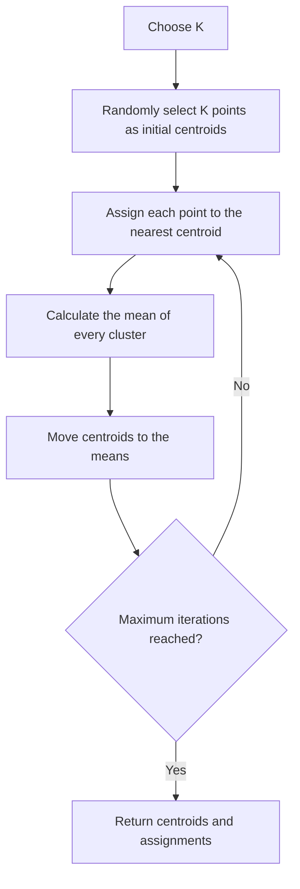

# K-Means: Discovering Groups in Data

**K-Means** is an unsupervised clustering algorithm that divides data into \(K\) groups. It searches for \(K\) center points, called **centroids**, such that examples in each group are close to their centroid.

The central intuition is:

> Points that are near one another belong in the same cluster.

This project implements K-Means from scratch using plain Python. It uses Euclidean distance, randomly selected starting centroids, and a fixed number of update iterations. The implementation is in [`main.py`](./main.py).

## The example: four points and two clusters

The script contains four two-dimensional points:

```text
(1.0, 1.0)
(1.5, 2.0)
(8.0, 8.0)
(9.0, 7.0)
```

It asks the algorithm to find:

```text
K = 2 clusters
```

The points naturally form two separated groups:

- A cluster around `(1, 1)` and `(1.5, 2)`
- A cluster around `(8, 8)` and `(9, 7)`

The expected final centroids for this data are approximately:

```text
Centroid 1 = ((1.0 + 1.5) / 2, (1.0 + 2.0) / 2)
           = (1.25, 1.5)

Centroid 2 = ((8.0 + 9.0) / 2, (8.0 + 7.0) / 2)
           = (8.5, 7.5)
```

## Euclidean distance

The distance between two points \(p=(x_1,y_1)\) and \(q=(x_2,y_2)\) is calculated with:

```text
distance(p, q) = sqrt((x₁ - x₂)² + (y₁ - y₂)²)
```

The implementation uses this distance in [`euclidean_distance()`](./main.py):

```python
math.sqrt(
    (p1[0] - p2[0]) ** 2
    + (p1[1] - p2[1]) ** 2
)
```

A smaller distance means that two points are more similar under the Euclidean metric.

## How K-Means works

K-Means alternates between two operations:

1. **Assignment:** assign every point to the nearest centroid.
2. **Update:** move each centroid to the mean of the points assigned to it.

These steps repeat for a fixed number of iterations or until the centroids stop changing.



In this implementation, `kmeans()` runs for `max_iter` iterations. It does not currently check for convergence before reaching that limit.

## Initializing the centroids

The script uses:

```python
random.sample(data, k)
```

This randomly chooses \(K\) existing data points as the first centroids. The selected starting points can affect the final solution.

Because initialization is random, running the script multiple times may produce:

- The same final clusters with different centroid order.
- A different local solution if the data is more complex.
- A cluster containing no points, although this small example will normally avoid that situation.

For reproducible experiments, set a random seed before calling `kmeans()`:

```python
random.seed(42)
```

## Assigning points to clusters

For every point, the implementation calculates its distance to each centroid:

```python
min_dist = float('inf')

for j, centroid in enumerate(centroids):
    dist = euclidean_distance(point, centroid)
    if dist < min_dist:
        min_dist = dist
        assignments[i] = j
```

The cluster with the smallest distance receives the point.

The `assignments` list stores one cluster index for every input point. For example:

```text
assignments = [0, 0, 1, 1]
```

means that the first two points belong to cluster `0`, while the final two points belong to cluster `1`.

## Updating the centroids

After assignment, each centroid is moved to the average position of its members:

```text
new centroid = (
    mean of member x-coordinates,
    mean of member y-coordinates
)
```

For cluster `0`, the calculation is:

```text
((1.0 + 1.5) / 2,
 (1.0 + 2.0) / 2)
= (1.25, 1.5)
```

For cluster `1`, the calculation is:

```text
((8.0 + 9.0) / 2,
 (8.0 + 7.0) / 2)
= (8.5, 7.5)
```

The implementation keeps an existing centroid when a cluster is empty:

```python
if members:
    new_centroids.append(...)
else:
    new_centroids.append(centroids[c])
```

This prevents a division-by-zero error but does not actively reinitialize the empty cluster.

## Cluster objective

K-Means seeks to minimize the within-cluster sum of squared distances:

```text
J = sum over every cluster c:
    sum over every point p in c:
        distance(p, centroid_c)²
```

This value is called **inertia** or the **within-cluster sum of squares**.

The algorithm does not calculate and print \(J\) in this example. However, this objective explains what K-Means is trying to improve: each update makes assigned points move closer to the centroid representing their cluster.

## The result

A representative run of the script prints:

```text
Centroids: [[1.25, 1.5], [8.5, 7.5]]
```

The final assignments place `(1.0, 1.0)` and `(1.5, 2.0)` near `(1.25, 1.5)`, while `(8.0, 8.0)` and `(9.0, 7.0)` are grouped near `(8.5, 7.5)`.

The script does not return or print the final assignments. `kmeans()` does include them in the returned dictionary:

```python
{
    'centroids': centroids,
    'assignments': assignments
}
```

## How this maps to the code

| Code | Purpose |
| --- | --- |
| `euclidean_distance(p1, p2)` | Calculates the Euclidean distance between two 2D points. |
| `random.sample(data, k)` | Randomly initializes \(K\) centroids from the available points. |
| `assignments` | Stores the cluster index assigned to every data point. |
| `min_dist` | Tracks the closest centroid while checking a point. |
| `members` | Collects all points assigned to one cluster. |
| `sum(p[0] for p in members) / len(members)` | Calculates the mean x-coordinate for a cluster. |
| `sum(p[1] for p in members) / len(members)` | Calculates the mean y-coordinate for a cluster. |
| `centroids` | Stores the current center of each cluster. |
| `max_iter` | Limits the number of assignment-and-update cycles. |

## Choosing \(K\)

The value of \(K\) is selected by the user before running the algorithm. Common strategies include:

- **Domain knowledge:** choose a meaningful number of categories.
- **Elbow method:** compare inertia for several values of \(K\) and look for diminishing improvements.
- **Silhouette analysis:** measure how similar points are to their own cluster relative to neighboring clusters.

This script only demonstrates \(K=2\). It does not include a method for automatically selecting the best value of \(K\).

## Limitations

- The final result can depend on random initialization.
- K-Means minimizes a local objective and can stop at a suboptimal solution.
- It assumes roughly spherical, similarly sized clusters.
- It is sensitive to outliers because centroids are arithmetic means.
- It assumes that the number of clusters \(K\) is known in advance.
- Euclidean distance makes feature scale important; features with larger ranges can dominate.
- It does not preserve the original cluster labels across separate runs.
- The implementation is limited to two-dimensional points.
- The fixed iteration count does not check whether convergence has occurred.
- Empty clusters are retained at their previous centroid instead of being reinitialized.

## Run it

From this folder, run:

```powershell
python main.py
```

The script uses only Python's built-in `math` and `random` modules.

## In one sentence

**K-Means repeatedly assigns points to the nearest centroid and moves each centroid to the mean of its points, discovering clusters without predefined labels.**

## Contact

- GitHub: [@iam-dev-Adarsh](https://github.com/iam-dev-Adarsh)
- Email: [iamvoid03@gmail.com](mailto:iamvoid03@gmail.com)