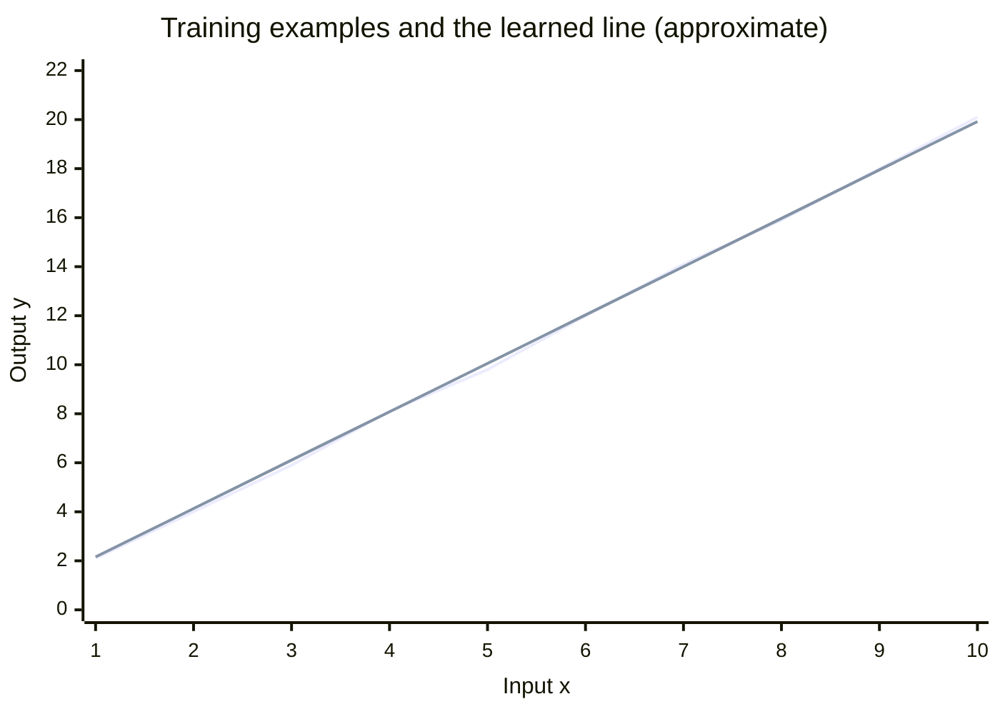
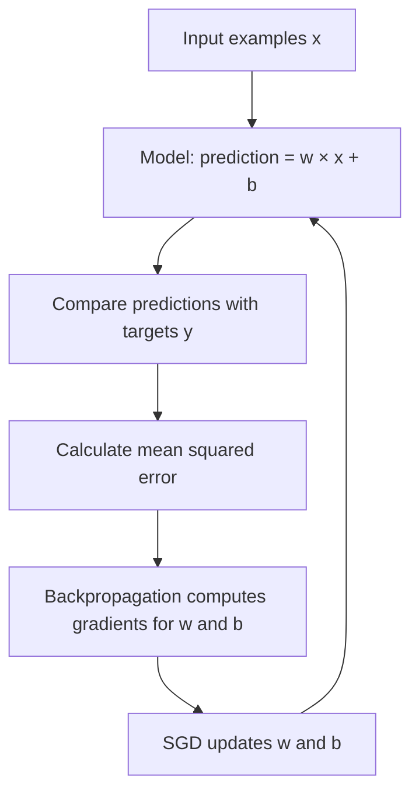

# Linear Regression: Learning the Best-Fit Line

Linear regression learns a straight line that makes useful predictions from examples.

Imagine you have a set of input/output pairs and want to describe their overall trend. A line gives a simple rule for turning an input into a prediction. Training adjusts the line until its predictions are, on average, close to the examples.

This project uses PyTorch to learn that line. The implementation is in [`main.py`](./main.py).

## The example data

The program supplies ten input values and ten corresponding target values:

| Input `x` | Target `y` |
| ---: | ---: |
| 1 | 2.1 |
| 2 | 4.0 |
| 3 | 5.9 |
| 4 | 8.1 |
| 5 | 9.8 |
| 6 | 12.0 |
| 7 | 14.1 |
| 8 | 15.9 |
| 9 | 18.0 |
| 10 | 20.1 |

The values are close to the rule `y = 2x`, but not perfectly on it. Linear regression looks for a line that captures this general relationship.



The first line represents the observed targets; the second approximates predictions from the example run. Training begins with random parameters, so exact results may vary slightly between runs.

## The model: a line with two learnable values

The model predicts with

```text
prediction = w × x + b
```

- **`w` (weight or slope)** controls how much the prediction changes when `x` increases by one.
- **`b` (bias or intercept)** shifts the line up or down.

For example, `w = 2` and `b = 0.1` gives `prediction = 2x + 0.1`. The program starts `w` and `b` at random values, then learns better ones from the data.

In the code, `nn.Parameter` marks `w` and `b` as values PyTorch should learn. The model's `forward` method applies the line equation to the inputs.

## How does the model know whether its line is good?

For every input, the model produces a prediction `ŷ`. It compares that prediction with the correct target `y`. The code measures the average squared difference using **mean squared error (MSE)**:

```text
MSE = average of (prediction − target)²
```

Squaring makes larger mistakes count more and prevents positive and negative errors from simply canceling each other out. A lower MSE means the predictions are closer to the targets overall.

The learning goal is to find values of `w` and `b` that reduce this loss.

## How training improves the line

Training repeats four main steps:

1. Use the current line to predict outputs.
2. Measure the prediction error with MSE.
3. Calculate how `w` and `b` contributed to that error.
4. Adjust `w` and `b` to reduce the error.



This is the connection to gradient descent: the gradients tell the optimizer how changing `w` or `b` would change the loss. Stochastic Gradient Descent (SGD) then takes a small step in the direction that lowers it.

In the code:

- `optimizer.zero_grad()` clears gradients left from the previous training step.
- `pred = model(xs)` calculates predictions.
- `loss.backward()` asks PyTorch to calculate gradients automatically.
- `optimizer.step()` updates the parameters using those gradients.

The loop performs this process for 100 epochs. An **epoch** here means one training pass over the full set of ten examples.

## Why the input and target lengths must match

Each input needs a corresponding target: `x = 1` pairs with `y = 2.1`, `x = 2` pairs with `y = 4.0`, and so on. This example has ten inputs and ten targets, so both `pred` and `ys` have shape `(10,)`.

The loss calculation subtracts one tensor from the other:

```python
pred - ys
```

If one tensor contains ten values and the other contains nine, PyTorch cannot compare the pairs element by element and raises a size-mismatch error. Keep the two data lists the same length and in matching order.

## What the example learns

The included run starts with `w` and `b` initialized randomly, then trains for 100 epochs with an SGD learning rate of `0.01`. One recorded run ends near:

```text
w ≈ 1.97
b ≈ 0.19
```

So its learned prediction rule is approximately:

```text
prediction ≈ 1.97 × x + 0.19
```

This is close to the pattern in the data. Because the initial parameters are random, your printed values can differ slightly.

## How this maps to the code

| Code | Purpose |
| --- | --- |
| `xs_data`, `ys_data` | Store the paired example inputs and targets. |
| `torch.tensor(...)` | Convert the Python lists into tensors PyTorch can process. |
| `LinearRegression` | Defines the line model and its learnable parameters `w` and `b`. |
| `forward(self, x)` | Computes `x * w + b`. |
| `loss = (pred - ys).square().mean()` | Calculates the mean squared error. |
| `torch.optim.SGD(...)` | Creates the optimizer that adjusts the parameters. |
| `loss.backward()` | Calculates gradients for the learnable parameters. |
| `optimizer.step()` | Applies an update using those gradients. |

## What linear regression is—and is not

Linear regression is useful when a roughly linear relationship is a reasonable model for the data. It does not prove that one variable causes another, and a straight line may not describe curved or more complex relationships well.

This example has one input feature and predicts one output. It demonstrates the training mechanics, but a real project also needs appropriate data, evaluation on unseen examples, and checks that the assumptions fit the problem.

## Run the example

From this folder, run:

```powershell
python main.py
```

## In one sentence

**Linear regression learns a slope and intercept that make a line's predictions as close as possible to known examples.**

## Contact

- GitHub: [@iam-dev-Adarsh](https://github.com/iam-dev-Adarsh)
- Email: [iamvoid03@gmail.com](mailto:iamvoid03@gmail.com)