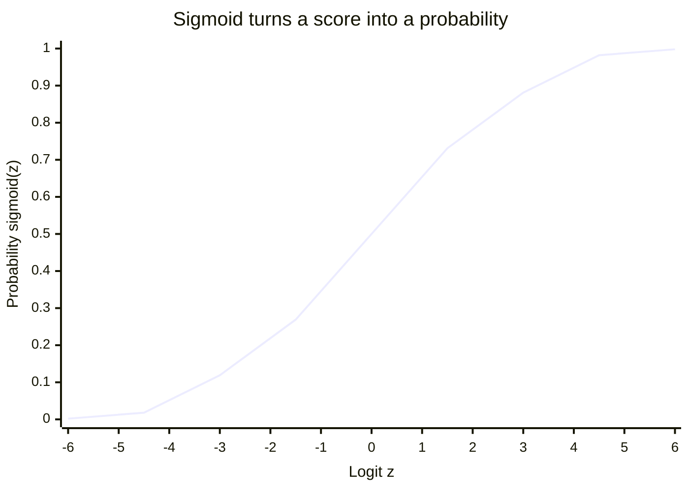
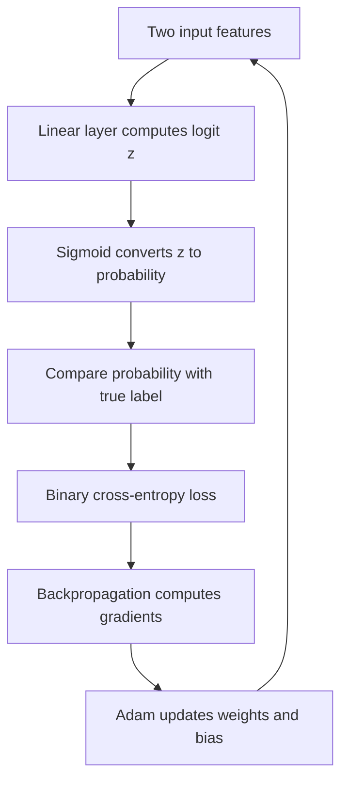

# Logistic Regression: Turning Features into Probabilities

Logistic regression is a model for **classification**. It uses input features to estimate the probability that an example belongs to a class.

Despite “regression” in its name, it is commonly used to answer classification questions such as:

- Is this email spam or not spam?
- Is a transaction suspicious or legitimate?
- Does this example belong to class `0` or class `1`?

This project uses PyTorch to learn a binary classifier from two input features. Its implementation is in [`main.py`](./main.py).

## The example: two classes, two features

Each example has two numbers, collected in `X`, and a label, collected in `y`:

| Feature 1 | Feature 2 | Label |
| ---: | ---: | ---: |
| 1 | 1 | 0 |
| 2 | 2 | 0 |
| 3 | 1 | 0 |
| 6 | 7 | 1 |
| 7 | 8 | 1 |
| 8 | 6 | 1 |

The label `0` identifies one class and `1` the other. The model learns from these labeled examples; it is not given a hand-written rule for separating them.

Here, **features** are the input measurements and the **label** is the class the model should learn to predict. The example uses small, clearly separated groups to make the classification idea easier to see.

## From input features to probability

First, the model combines the features into a score called a **logit**:

```text
z = w₁x₁ + w₂x₂ + b
```

Here, `x₁` and `x₂` are the two input features, `w₁` and `w₂` are learned weights, and `b` is a learned bias. The logit can be any real number; by itself, it is not a probability.

Next, the model passes that score through the **sigmoid** function:

```text
sigmoid(z) = 1 / (1 + e⁻ᶻ)
```

Sigmoid maps any real-valued score to a number strictly between `0` and `1`. The result can be interpreted as the model's estimated probability for class `1`.



For example:

- A logit far below zero produces a probability near `0`.
- A logit of `0` produces a probability of `0.5`.
- A logit far above zero produces a probability near `1`.

The probability is not the final class label by itself. To turn it into a class, choose a threshold. A common choice is `0.5`: below it, predict class `0`; at or above it, predict class `1`. The current `main.py` trains the model but does not apply a threshold or print class predictions.

## How the model learns

At the start, the model's weights and bias do not yet separate the classes usefully. Training adjusts them using the labeled examples:



Each training pass follows these steps:

1. **Predict:** compute a probability for each example.
2. **Measure error:** compare the probabilities with the known labels.
3. **Calculate gradients:** determine how the model's parameters contributed to the error.
4. **Update parameters:** adjust the weights and bias to reduce the error.
5. **Repeat:** run another pass over the training data.

In the script, the loop repeats this process for 1,000 epochs.

## The loss: binary cross-entropy

To measure classification error, the code uses **binary cross-entropy (BCE)**. For one example with label `y` and predicted class-1 probability `p`, its loss is:

```text
loss = -[y × log(p) + (1 - y) × log(1 - p)]
```

This loss rewards confident, correct probabilities and strongly penalizes confident, incorrect ones:

- If the true label is `1`, predicting a probability close to `1` gives a small loss.
- If the true label is `0`, predicting a probability close to `0` gives a small loss.
- Being confidently wrong gives a large loss.

The code averages this loss across the examples. The goal of training is to make that average smaller.

## How this maps to the PyTorch code

| Code | What it does |
| --- | --- |
| `X` | Stores six examples, each with two features. Its shape is `(6, 2)`. |
| `y` | Stores the six binary labels in the same order as the examples. |
| `nn.Linear(2, 1)` | Learns two feature weights and a bias, producing one logit per example. |
| `torch.sigmoid(...)` | Converts each logit into a class-1 probability. |
| `.squeeze()` | Removes the output's size-one dimension so predictions and labels have matching shapes. |
| `binary_cross_entropy(pred, y)` | Measures the mean error between predicted probabilities and labels. |
| `loss.backward()` | Calculates gradients for the model's learnable parameters. |
| `optimizer.step()` | Uses Adam to update those parameters. |
| `optimizer.zero_grad()` | Clears gradients from the previous training step before calculating new ones. |

The `pred` values are probabilities, not logits. That is why the code applies sigmoid before passing predictions to `binary_cross_entropy`.

## What the printed loss tells you

Every 20 epochs, the program prints the current BCE loss. A generally decreasing loss indicates that the probabilities are fitting the training labels better. Small variations can occur; one loss value alone does not tell you how well the classifier will work on new examples.

The script currently prints training loss and a completion message. It does **not** print predicted probabilities, class labels, accuracy, or a decision boundary.

## Important limitations

- The data has only six examples, so it is a tiny demonstration—not enough to establish real-world performance.
- Logistic regression learns a **linear decision boundary** in feature space. It may not fit patterns that require a curved or more complex boundary.
- A predicted probability is a model estimate; it is not automatically a guarantee that the true chance is exactly that value.
- Evaluating on the same examples used for training does not show how well the model generalizes. Real applications should also assess held-out data and choose evaluation measures suited to the problem.
- This implementation applies sigmoid and then binary cross-entropy explicitly. PyTorch also provides `BCEWithLogitsLoss`, which combines those operations in a numerically stable way when a model returns logits directly.

## In one sentence

**Logistic regression learns feature weights that turn an input into a probability of belonging to a class.**

## Contact

- GitHub: [@iam-dev-Adarsh](https://github.com/iam-dev-Adarsh)
- Email: [iamvoid03@gmail.com](mailto:iamvoid03@gmail.com)