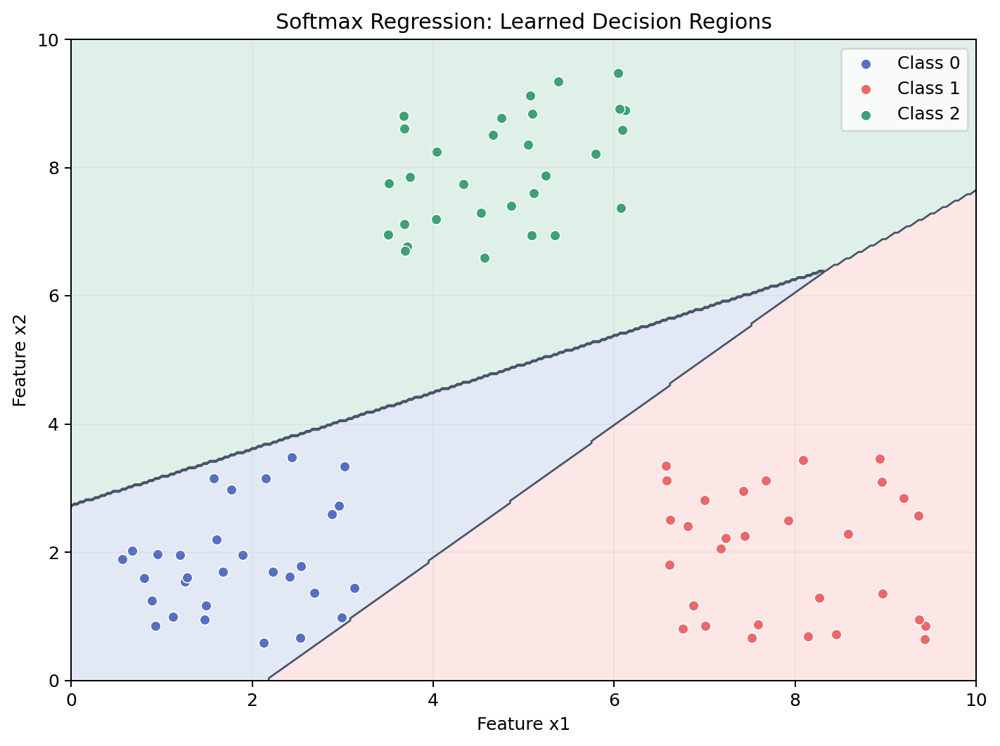
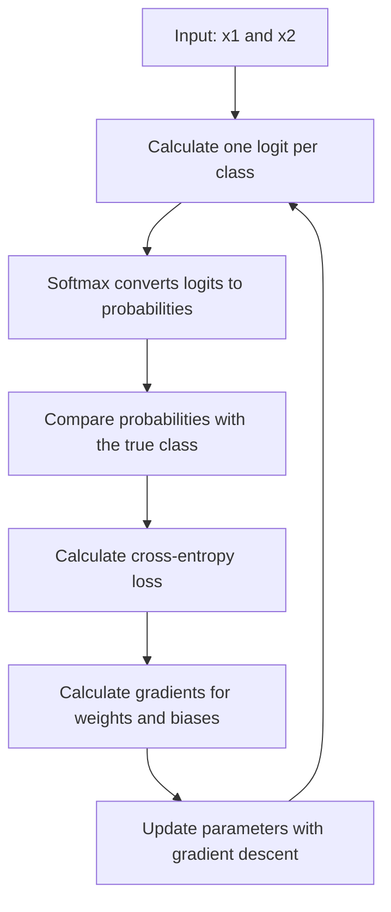

# Softmax Regression: Classifying More Than Two Groups

Softmax regression is a classification model that estimates which of several classes an example belongs to. It takes input features, calculates a score for every class, and turns those scores into probabilities that add up to 1.

This project builds a three-class classifier **from scratch in Python**. It uses no machine-learning framework: the code implements the softmax function, cross-entropy loss, gradients, and parameter updates directly. Matplotlib is used to animate the decision regions. See [`main.py`](./main.py).

## The example data

Each example has two numerical features, `x1` and `x2`, and a class label `y`. The program generates 30 examples for each of three classes—90 examples total:

| Class | Approximate center `(x1, x2)` | Color in the plot |
| --- | --- | --- |
| `0` | `(2, 2)` | Blue |
| `1` | `(8, 2)` | Red |
| `2` | `(5, 8)` | Green |

Random variation is added around each center, so the exact points change each time the program runs. The figure below shows a representative training run:



Each dot is a training example. The shaded background shows the class the trained model predicts at each location, and the lines mark where its predicted class changes. This figure uses a fixed random seed so it stays consistent in the README; the running program generates new data and random initial parameters each time.

The model learns to separate the groups using both features together.

## From features to a class

For each class `k`, the model calculates a **logit** (an unrestricted score):

```text
zₖ = wₖ₁ × x1 + wₖ₂ × x2 + bₖ
```

Here, `wₖ₁` and `wₖ₂` are that class's feature weights, and `bₖ` is its bias. A larger logit means the model currently favors that class more—but logits are not probabilities.

Softmax converts the class logits into probabilities:

```text
P(class k) = exp(zₖ) / sum(exp(zⱼ) for every class j)
```

For three classes, the output might be:

```text
Class 0: 0.80
Class 1: 0.10
Class 2: 0.10
         ────
         1.00
```

The model predicts the class with the highest probability. In the example above, that is class `0`. In the code, `predict()` returns the index of the largest softmax probability.

To keep calculations numerically stable, `softmax()` subtracts the largest logit before exponentiating:

```text
softmax(z) = softmax(z - max(z))
```

Subtracting the same value from every logit does not change the resulting probabilities, but it helps avoid excessively large exponentials.

## How the model learns

The weights and biases start with small random values, so the initial decision regions are not yet useful. Training repeatedly measures prediction error and adjusts those parameters:



### 1. Measure the error with cross-entropy

For an example whose true class is `y`, the loss is the negative log-probability assigned to that correct class:

```text
loss = -log(P(true class))
```

If the model assigns high probability to the correct class, its loss is small. If it assigns low probability to the correct class, its loss is large. The program averages the loss over all training examples.

### 2. Calculate gradients

For class `k`, the error used by the gradient is:

```text
errorₖ = P(class k) - targetₖ
```

`targetₖ` is `1` for the true class and `0` for the other classes. The code uses this error to calculate how each class's weights and bias contributed to the loss.

### 3. Update the parameters

The code averages the gradients across the full dataset and takes a step opposite each gradient:

```text
parameter = parameter - learning_rate × average_gradient
```

This is **full-batch gradient descent**: each update uses all 90 examples. The configured learning rate is `0.05`, and training runs for `300` epochs. An epoch here means one full pass over the generated data.

## Understanding the animated plot

At each epoch, the program samples locations across the feature space and colors each location according to the model's current prediction:

- **Colored background:** the class the model would predict at that location.
- **Colored points:** the generated training examples, colored by their true class.
- **Region boundaries:** places where the model's preferred class changes.
- **Title:** the current epoch and the calculated loss.

At the start, the regions are based on random parameters. As training proceeds, the regions should move to better separate the three groups. The background is an approximation sampled on a grid with spacing `0.35`; it is not an exact rendering of every boundary point.

## What the printed results mean

Every 10 epochs, the program prints:

- **Loss:** average cross-entropy calculated at the start of that epoch, before that epoch's parameter update.
- **Accuracy:** fraction of the generated training examples classified correctly, calculated after the update.

At the end, it prints the final training accuracy. Since the data and initial parameters are random, results can vary between runs. Accuracy is measured on the same examples used for training, so it demonstrates learning on this toy dataset—not performance on unseen data.

## How this maps to the code

| Code | Purpose |
| --- | --- |
| `generate_data()` | Creates 30 random two-feature examples for each class. |
| `softmax(logits)` | Converts class scores to probabilities that sum to 1. |
| `predict(...)` | Returns the class with the largest predicted probability. |
| `calculate_loss(...)` | Computes mean cross-entropy across the dataset. |
| `calculate_gradients(...)` | Computes average gradients for every class's weights and bias. |
| `draw(...)` | Samples and displays the current predicted regions and training points. |
| `train()` | Initializes parameters, runs the training loop, and reports training accuracy. |

## Run it

Install Matplotlib if it is not already available:

```powershell
python -m pip install matplotlib
```

Then run from this folder:

```powershell
python main.py
```

The program animates the training in a plot window. After training completes, close the plot window normally to exit.

## Limitations

- The dataset is small, synthetic, and intentionally arranged into clear groups.
- Each class has a linear score, so the resulting class boundaries are linear; more complex patterns may need a different model.
- The displayed accuracy is training accuracy, not a measure of performance on new examples.
- Random data generation and random initial parameters mean results are not identical between runs.
- The current script does not use a separate validation or test set.

## In one sentence

**Softmax regression learns one score per class, converts those scores into probabilities, and adjusts its parameters to give the correct class a higher probability.**

## Contact

- GitHub: [@iam-dev-Adarsh](https://github.com/iam-dev-Adarsh)
- Email: [iamvoid03@gmail.com](mailto:iamvoid03@gmail.com)