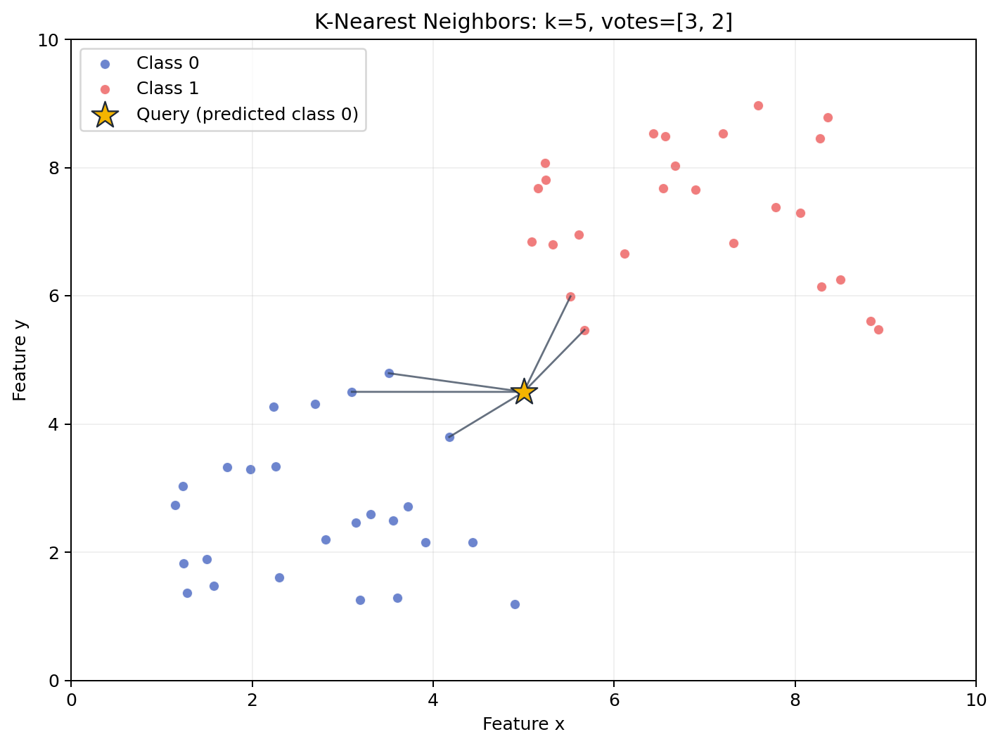
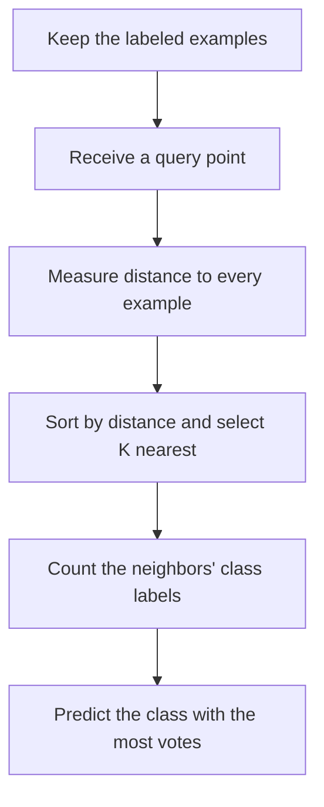

# K-Nearest Neighbors: Classify by Looking Nearby

K-nearest neighbors (KNN) is a simple algorithm for predicting the class of a new example. Its intuition is:

> Look at the most similar examples you already know, then let them vote.

This project implements a two-class KNN classifier in Python. It generates sample points, measures their Euclidean distance from a query, finds the `K` closest points, and predicts the majority class. See [`main.py`](./main.py).

## The example

Each data point has two features, `x` and `y`, plus a class label:

- **Class 0** points are generated around `(3, 3)`.
- **Class 1** points are generated around `(7, 7)`.
- There are 25 randomly generated points for each class.
- The query to classify is `(5, 4.5)`.
- `K = 5`: the classifier considers the five nearest points.

The figure below shows a representative run. Lines connect the query to its five nearest neighbors, and the query is marked with a star.



The points vary because `generate_data()` uses randomness. The figure is one reproducible sample; the program does not set a random seed, so your output may differ.

## How KNN makes a prediction

KNN is an instance-based, or **lazy**, learning method. It does not first fit a formula to the training data. Instead, it keeps the examples and uses them when a new query arrives:



In this implementation, the steps are:

1. Calculate the distance from the query to each data point.
2. Sort the points from closest to farthest.
3. Keep the first `K` points.
4. Count how many neighbors belong to each class.
5. Return the class with the most votes.

In the representative plot, the five neighbors vote **3 for Class 0** and **2 for Class 1**, so the predicted class is **Class 0**. Since the sample data is random, another run can produce a different vote.

## Measuring “near”: Euclidean distance

The code uses Euclidean distance, the straight-line distance between two points in a plane. For query `(xq, yq)` and example `(xp, yp)`:

```text
distance = √((xq - xp)² + (yq - yp)²)
```

For example, the distance from `(5, 4.5)` to `(6, 5)` is:

```text
√((5 - 6)² + (4.5 - 5)²)
= √(1 + 0.25)
≈ 1.12
```

A smaller distance means the points are closer in the feature space. In `main.py`, `euclidean_distance(a, b)` calculates this value, and `knn_predict(...)` uses it to order the examples.

## What does `K` control?

`K` is the number of neighbors that get to vote.

- A **small K** is strongly influenced by the nearest few points and can be sensitive to noisy examples.
- A **larger K** uses more examples for each decision, which can smooth predictions but may blur local patterns.

There is no universally best K; it depends on the data. Here, `K = 5`. It means five neighbors—not five-fold cross-validation. The `COLORS` list names the two classes for display but is not used by the prediction calculation.

## How this maps to the code

| Code | Purpose |
| --- | --- |
| `generate_data()` | Creates 25 points near each of two class centers. |
| `euclidean_distance(a, b)` | Computes the straight-line distance between two points. |
| `knn_predict(query, data, k)` | Finds the `k` nearest examples, counts their labels, and returns the predicted class, vote counts, and neighbors. |
| `sorted_data[:K]` | Selects the first `K` points after sorting by distance. |
| `votes` | Counts the neighbors belonging to class 0 and class 1. |
| `query` | The new point the program classifies. |

The code prints each of the five neighbors and its distance, then prints the class vote totals and the final prediction.

## Important details and limitations

- **Feature scale matters.** Euclidean distance can be dominated by a feature with much larger numeric values. Real datasets often need feature scaling before KNN.
- **KNN can be expensive at prediction time.** This implementation computes and sorts distances to all training points for every query.
- **Distance reflects the chosen representation.** Nearby in the measured features does not always mean similar in the real-world task.
- **Ties are possible.** The current code uses `votes.index(max(votes))`, so an exact tie is resolved in favor of class `0` because it appears first.
- **This is a small synthetic demonstration.** Its generated points and one query are not a meaningful evaluation of performance on unseen real data.

## Run it

From this folder, run:

```powershell
python main.py
```

The script uses only Python's built-in `math` and `random` modules.

## In one sentence

**KNN predicts a new point's class by finding the closest labeled examples and letting their labels vote.**

## Contact

- GitHub: [@iam-dev-Adarsh](https://github.com/iam-dev-Adarsh)
- Email: [iamvoid03@gmail.com](mailto:iamvoid03@gmail.com)