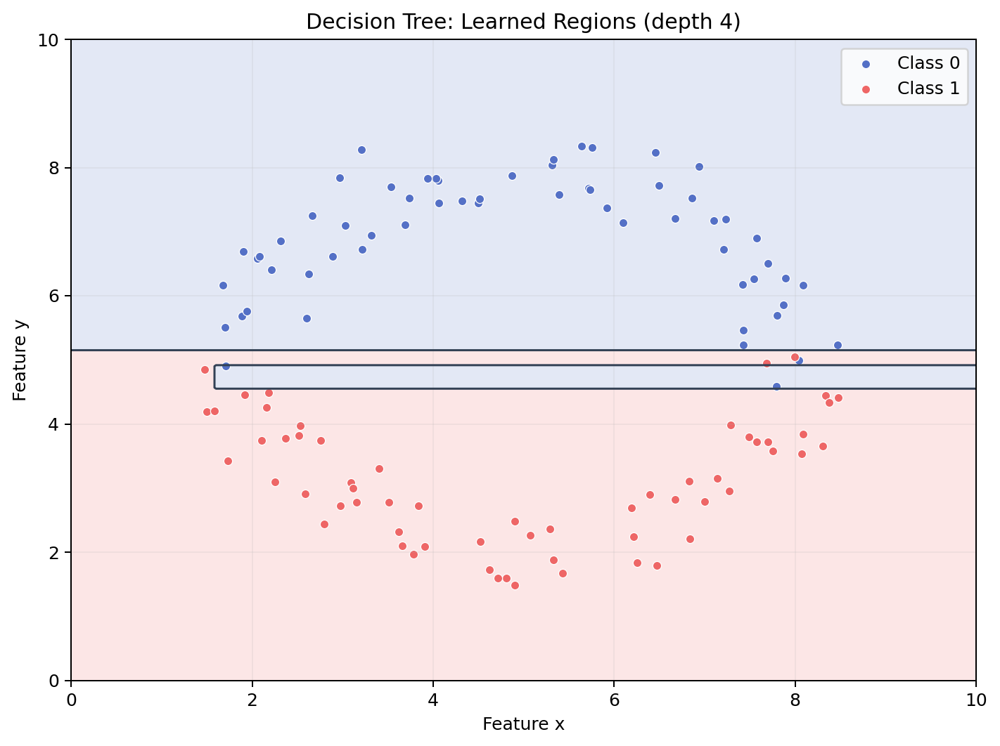
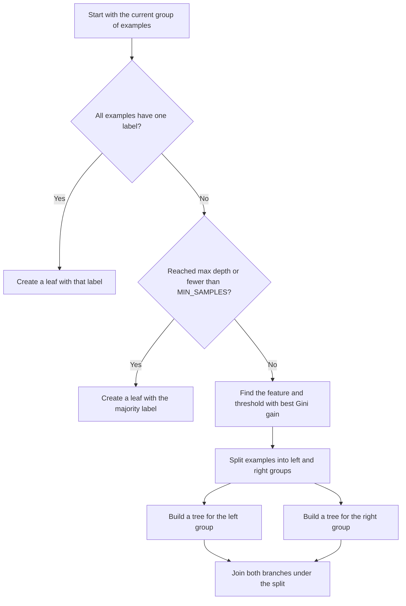

# Decision Trees: Learning a Sequence of Yes-or-No Questions

A decision tree classifies an example by asking a series of questions about its features. Each answer sends the example down a branch until it reaches a leaf, where the tree makes a prediction.

Think of it like a flowchart: **ask a question, follow the matching path, and arrive at a decision**. This project builds a small binary decision tree from scratch in Python using Gini impurity to choose its questions. See [`main.py`](./main.py).

## The example data

The program generates 120 two-dimensional points:

- 60 points labeled **Class 0**, around an upper semicircular arc.
- 60 points labeled **Class 1**, around a lower semicircular arc.
- Each point has two features, `x` and `y`, with a small random offset.

The two labels are the answers the tree is meant to learn. A decision tree does not know the generating rule; it learns splits from the examples and their labels.

The plot shows the learned prediction regions for one reproducible run:



The dots are the generated examples. The shaded regions show which class the trained tree predicts at each location. The boundary is made of horizontal and vertical steps because this tree's questions split one feature at a time, such as `y <= 4.53` or `x <= 1.59`. The data and parameters are random when you run the program, so your tree and accuracy may differ from the figure.

## What a split means

A split asks whether one feature is less than or equal to a threshold:

```text
Is y <= 4.53?
├── Yes: follow the left branch
└── No:  follow the right branch
```

Each child can ask another question. A path through the tree might look like:

```text
y <= 4.53?  No
  y <= 5.14?  Yes
    x <= 1.59?  No
      → predict a class at the leaf
```

The tree is learned from the training examples; these questions are not manually written in advance.

## How does the tree choose a question?

The code searches for a feature (`x` or `y`) and threshold that make the resulting groups as pure as possible. A group is **pure** when its examples mostly—or entirely—belong to one class.

### Gini impurity

Gini impurity measures how mixed the labels in a group are:

```text
Gini = 1 - sum(pᵢ²)
```

Here, `pᵢ` is the fraction of examples belonging to class `i`.

- If every example in a group has the same label, its Gini impurity is `0`.
- For an evenly mixed group containing two classes, its Gini impurity is `0.5`.

### Information gained by a split

For each candidate split, the code calculates the weighted impurity of the left and right groups, then subtracts it from the impurity before splitting:

```text
gain = parent Gini
       - (left size / parent size) × left Gini
       - (right size / parent size) × right Gini
```

A larger gain means the split reduced the label mixture more. `best_split()` tests thresholds between neighboring observed feature values and returns the split with the largest gain.

## Growing the tree



The implementation stops growing a branch when:

- all examples in the current group have the same label;
- the current depth reaches `MAX_DEPTH` (`4`);
- the current group has fewer than `MIN_SAMPLES` (`4`) examples; or
- no feature split is available.

When it stops before reaching a pure group, it creates a leaf that predicts the **majority label** in that group. In this code, `MIN_SAMPLES` checks the size of the group before it is split; it does not guarantee that each child contains at least four examples.

## Predicting with the trained tree

To classify a new point, `predict()` starts at the root:

1. Read the feature and threshold stored at the current node.
2. If the point's feature is less than or equal to the threshold, follow the left child; otherwise, follow the right.
3. Repeat until reaching a leaf.
4. Return the class label stored in that leaf.

For example, the script tests `(5, 7)`, `(5, 3)`, and `(8, 5)`. Their predictions can vary with the randomly generated training points.

## How this maps to the code

| Code | Purpose |
| --- | --- |
| `generate_data()` | Creates the two noisy classes of points. |
| `gini(labels)` | Measures how mixed a group's labels are. |
| `best_split(data)` | Searches feature thresholds and selects the split with the greatest Gini gain. |
| `build_tree(data, depth)` | Recursively creates split nodes and majority-class leaves. |
| `predict(node, point)` | Follows split questions to a leaf and returns its label. |
| `tree_depth(node)` | Counts the longest root-to-leaf path. |
| `print_tree(node)` | Displays the learned questions and leaf predictions. |

## Reading the reported accuracy

The script reports **training accuracy**: the fraction of generated training points the tree classifies correctly. A high training accuracy shows how well the tree fits those points, but it does not establish how well it predicts new data. The script does not reserve a separate test set.

Tree size and `MAX_DEPTH` affect the trade-off:

- A shallow tree is easier to inspect but may not capture enough structure.
- A deeper tree can fit more details, including noise, and may generalize poorly.

## Limitations

- The tree uses axis-aligned splits (`x <= threshold` or `y <= threshold`), so curved boundaries are approximated with step-shaped regions.
- The generated points and model are random, so results vary across runs.
- Gini-based decisions can depend on the scale and representation of features through the candidate thresholds.
- A single tree can be sensitive to small changes in data. Ensembles such as random forests combine many trees to reduce some of that sensitivity.

## Run it

From this folder, run:

```powershell
python main.py
```

The example uses only Python's built-in `math` and `random` modules.

## In one sentence

**A decision tree learns a sequence of feature-based questions that divides examples into groups and predicts each group's majority class.**

## Contact

- GitHub: [@iam-dev-Adarsh](https://github.com/iam-dev-Adarsh)
- Email: [iamvoid03@gmail.com](mailto:iamvoid03@gmail.com)