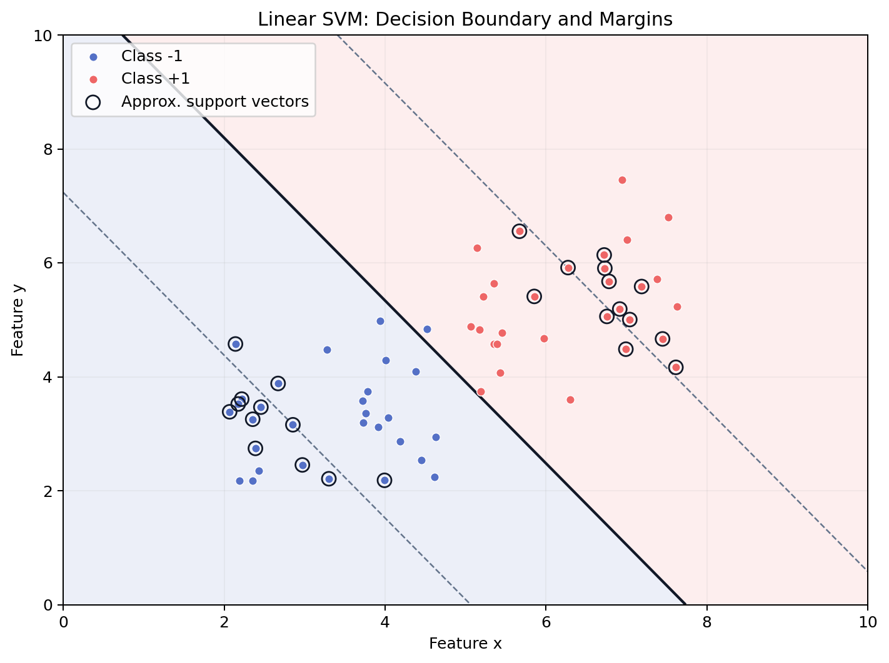
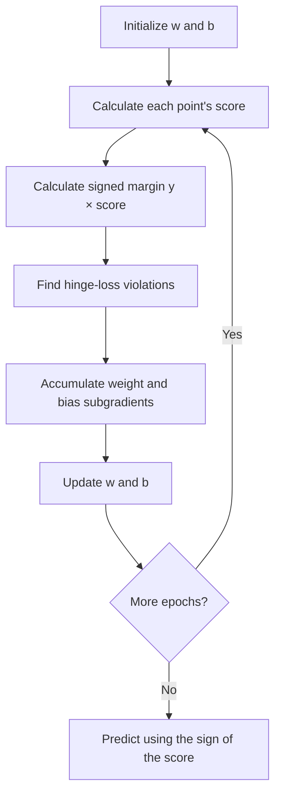

# Support Vector Machines: Finding a Boundary with a Wide Margin

A **Support Vector Machine (SVM)** is a supervised learning model commonly used for classification. A linear SVM separates two classes with a line (in two dimensions) or a hyperplane (in higher dimensions). It aims not only to separate the classes, but to place the boundary with as wide a margin as possible.

This project implements a linear soft-margin SVM using plain Python. It generates two classes, learns a weight vector and bias with subgradient descent, and reports predictions and approximate support vectors. See [`main.py`](./main.py).

## The data in this example

The program creates 60 two-feature examples:

- **Class `-1`** points have coordinates near `(2, 2)` through `(5, 5)`.
- **Class `+1`** points are shifted to the right and upward, with some additional variation in `y`.
- Each point has two features, `x` and `y`, and a label of either `-1` or `+1`.

The two labels are important: the hinge-loss formula uses `-1` and `+1` rather than `0` and `1`.

The figure below shows a representative training run:



- The **solid line** is the decision boundary, where the model's score is zero.
- The **dashed lines** mark the two margin boundaries, where the signed score is `-1` and `+1`.
- The **shaded regions** indicate which class the model predicts on each side.
- The **circled points** are approximate support vectors, selected by the code when their signed score is close to `1`.

The plot uses a fixed random seed to make the image reproducible. The program itself does not set a seed, so your generated points, boundary, and results may look different each run.

## The decision boundary

For a point with features `(x, y)`, the SVM calculates a score:

```text
score = w₁x + w₂y + b
```

`w = [w₁, w₂]` is the **weight vector** and `b` is the **bias**. The prediction is based on the sign of the score:

```text
score >= 0  → predict +1
score <  0  → predict -1
```

The decision boundary is all points where `w₁x + w₂y + b = 0`. In two dimensions, this equation describes a straight line.

## What is the margin?

The decision boundary separates the classes. The SVM also considers two parallel margin boundaries:

```text
w₁x + w₂y + b = +1
w₁x + w₂y + b = -1
```

The distance between these boundaries is:

```text
margin width = 2 / ||w||
```

where `||w|| = √(w₁² + w₂²)` is the length of the weight vector. For a fixed separation, a smaller weight norm gives a wider margin. A wider margin can make a classifier less sensitive to small changes in the input.

Points that lie on or inside the margin are especially influential in defining the boundary. These are the **support vectors**.

## Hinge loss: penalizing margin violations

For an example with label `yᵢ ∈ {-1, +1}` and score `f(xᵢ)`, the signed margin is:

```text
mᵢ = yᵢ × f(xᵢ)
```

The hinge loss is:

```text
hingeᵢ = max(0, 1 - mᵢ)
```

This gives an intuitive rule:

- If the example is correctly classified and beyond the margin (`mᵢ >= 1`), its hinge loss is `0`.
- If it is inside the margin, it gets a positive loss.
- If it is on the wrong side of the decision boundary, its loss is larger.

The implementation reports the **average hinge loss**. This is only the data-fitting part of the SVM objective; it does not include the weight regularization term.

## The training objective and update

The code uses the soft-margin objective:

```text
J(w, b) = 1/2 × ||w||² + (C / N) × sum(hingeᵢ)
```

The first term favors a smaller weight vector (and therefore a wider margin). The second term penalizes examples that violate the margin. `C` controls the balance: a larger `C` places more emphasis on reducing hinge loss.

Training iterates over all examples to accumulate subgradients, then updates the parameters:

```text
w ← w - learning_rate × gradient_w
b ← b - learning_rate × gradient_b
```

In the script, the weight gradient contains the regularization contribution `w` plus the average hinge-loss gradient. The bias gradient comes from the hinge-loss term. The configured values are `C = 1.0`, `LR = 0.005`, and `EPOCHS = 5000`.



## Support vectors in this implementation

`find_support_vectors()` checks whether a point's signed margin is close to `1`:

```text
abs(y × score - 1) < eps
```

The default tolerance is `eps = 0.3`. This is a practical approximation for displaying points near the margin, not a full dual-optimization support-vector calculation. In a soft-margin SVM, points that violate the margin can also be support vectors; this simple filter may not include every such point.

## How this maps to the code

| Code | Purpose |
| --- | --- |
| `generate_data()` | Creates labeled examples for the two classes. |
| `train_svm(data)` | Learns weights and bias with batch subgradient updates. |
| `w` | Defines the orientation of the separating line and affects its margin width. |
| `b` | Shifts the decision boundary. |
| `predict(w, b, point)` | Returns `+1` or `-1` based on the score's sign. |
| `find_support_vectors(w, b, data)` | Finds points whose signed margin is within a tolerance of `1`. |
| `margin = 2 / norm` | Calculates the distance between the two margin boundaries. |

## Reading the results

- **Hinge loss** indicates how much the training points violate the desired margin, averaged over the dataset. Lower is generally better, but the code prints hinge loss without the regularization term.
- **Margin width** is the distance between the `-1` and `+1` score boundaries.
- **Number of support vectors** is the count found by the implementation's tolerance-based filter.
- **Training accuracy** is the fraction of generated training examples classified correctly.
- **Decision value** is the raw score before converting it to a class label.

Training accuracy is measured on the same points used to train the model. It does not by itself show how well the classifier performs on unseen data.

## Run it

From this folder, run:

```powershell
python main.py
```

The example uses only Python's built-in `math` and `random` modules.

## In one sentence

**A linear SVM learns a boundary that separates two classes while balancing margin width against the penalty for examples inside or beyond the margin.**

## Contact

- GitHub: [@iam-dev-Adarsh](https://github.com/iam-dev-Adarsh)
- Email: [iamvoid03@gmail.com](mailto:iamvoid03@gmail.com)