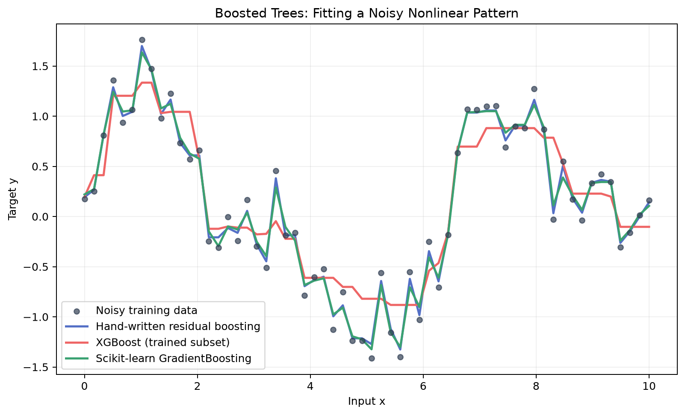
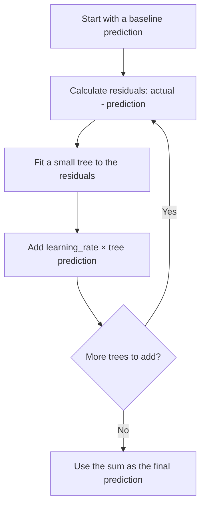

# Gradient Boosting and XGBoost: Improving Predictions One Tree at a Time

**Boosting** builds a strong predictor by adding a sequence of smaller models. Each new tree focuses on patterns the current ensemble has not yet captured.

This project compares three regression approaches on a noisy, nonlinear dataset:

1. A hand-written gradient-boosting loop that fits trees to residuals.
2. XGBoost's `XGBRegressor`, trained with validation-based early stopping.
3. Scikit-learn's `GradientBoostingRegressor`.

The script is [`main.py`](./main.py). The chart below gives a visual comparison of their fitted curves on one run:



The blue and green curves are fit on the full dataset, while XGBoost is trained on a train split and uses a validation split for early stopping. The chart is for intuition; the RMSE values printed by the script are **not a direct apples-to-apples benchmark**, because the approaches are evaluated on different data.

## The example data

The script creates 60 input values evenly spaced from `0` to `10`. Each target is generated from a smooth, nonlinear signal plus random noise:

```text
y = sin(x) + 0.4 × sin(2x) + noise
```

The model sees `x` and its target `y`, and tries to predict `y` for a given `x`. The underlying signal curves up and down, which a single straight line would not represent well.

## The core idea: learn from what remains unexplained

Start with a simple prediction—for this script, the mean target value. Then:

1. Compare predictions with the actual targets.
2. Calculate the **residuals**: `actual - predicted`.
3. Train a small decision tree to predict those residuals.
4. Add a fraction of the tree's prediction to the ensemble.
5. Repeat, letting each new tree refine the current model.



The final model is an **additive ensemble**: a baseline plus the contributions of many trees.

## Hand-written residual boosting

The first section of `main.py` makes the boosting process visible:

```text
prediction₀ = mean(y)
residualsₜ = y - predictionₜ₋₁
predictionₜ = predictionₜ₋₁ + learning_rate × treeₜ(x)
```

The tree is trained on the residuals, not directly on the original targets. In this example, the loss is mean squared error, whose negative gradient with respect to the predictions is the residual. This is why fitting a tree to residuals is a simple form of gradient boosting.

The settings are:

- **40 trees** (`N_TREES`)
- **Learning rate 0.3** (`LR`), which scales each tree's contribution
- **Maximum tree depth 3** (`MAX_DEPTH`), limiting how complex each individual tree can be

The script prints the training RMSE every ten trees.

## What XGBoost adds

XGBoost is an optimized gradient-boosting library. It retains the additive-tree idea but adds methods and controls that make boosting efficient and help manage model complexity. It supports regularization, sampling, and other features beyond the hand-written residual loop.

In this script, `XGBRegressor` is configured with:

- `n_estimators=100`: an upper limit on the number of boosting rounds;
- `learning_rate=0.1`: scales each tree's contribution;
- `max_depth=3`: limits the depth of each tree;
- `subsample=0.8`: samples part of the training rows for each tree;
- `colsample_bytree=0.8`: samples part of the features for each tree;
- `reg_lambda=1.0`: applies L2 regularization;
- `early_stopping_rounds=10`: stops when the validation score does not improve for ten rounds.

The dataset is split into training and validation portions. The model learns from the training portion and uses validation RMSE to decide when to stop. `best_iteration` identifies the best boosting round found during that process.

The script also prints `model.feature_importances_`. Because this example has just **one input feature** (`x`), its importance output contains one value, shown as `[1.]`. This says how the model's split-based importance is distributed across the available features; it does not mean the model is 100% accurate.

## Scikit-learn GradientBoostingRegressor

The third section uses scikit-learn's `GradientBoostingRegressor` with 100 trees, a learning rate of `0.1`, maximum depth `3`, and row subsampling of `0.8`.

Unlike the XGBoost section, this model is fit and scored on the full dataset in the current script. Its reported RMSE is therefore **training RMSE**, not validation RMSE. Training error usually looks more optimistic than error on examples the model did not train on.

## How to read the results

The script reports:

- **Hand-written boosting RMSE:** evaluated on the same full dataset used to fit its trees.
- **XGBoost validation RMSE:** evaluated on the held-out validation split.
- **Scikit-learn RMSE:** evaluated on the full dataset used to fit the model.
- **XGBoost best round:** the boosting round selected by validation-based early stopping.

Because the data partitions differ, do not rank the three methods by comparing these printed RMSE values directly. A fair benchmark would use the same train, validation, and test splits for each model, and compare them on the same held-out test data.

## How this maps to the code

| Code | Purpose |
| --- | --- |
| `X`, `y` | Create the one-feature input and noisy regression target. |
| `residuals = y - preds` | Calculate the errors the next hand-written tree should learn. |
| `DecisionTreeRegressor` loop | Fit trees to residuals and add their scaled predictions. |
| `train_test_split(...)` | Separate data for XGBoost training and validation. |
| `xgb.XGBRegressor(...)` | Configure the XGBoost model. |
| `early_stopping_rounds=10` | Stop XGBoost if validation performance stops improving. |
| `model.feature_importances_` | Report the fitted XGBoost model's feature importance. |
| `GradientBoostingRegressor(...)` | Configure and train scikit-learn's gradient-boosting model. |
| `RMSE` | Report root mean squared error; lower is better when measured on the same data split. |

## Install dependencies

The script requires NumPy and scikit-learn. The XGBoost comparison also requires XGBoost:

```powershell
python -m pip install numpy scikit-learn xgboost
```

Run the script from this folder:

```powershell
python main.py
```

## Limitations

- The dataset is small, synthetic, and contains only one feature.
- The script does not use a separate test set for final evaluation.
- The hand-written and scikit-learn models report training error, while XGBoost reports validation error.
- The XGBoost `try` block skips its section if XGBoost is missing, but NumPy and scikit-learn are imported outside that block and are required for the rest of the script.
- Feature importance from a single feature provides little comparative insight.

## In one sentence

**Gradient boosting builds an ensemble by adding trees that improve the current predictions, and XGBoost provides an optimized, regularized implementation of that idea.**

## Contact

- GitHub: [@iam-dev-Adarsh](https://github.com/iam-dev-Adarsh)
- Email: [iamvoid03@gmail.com](mailto:iamvoid03@gmail.com)567=try7