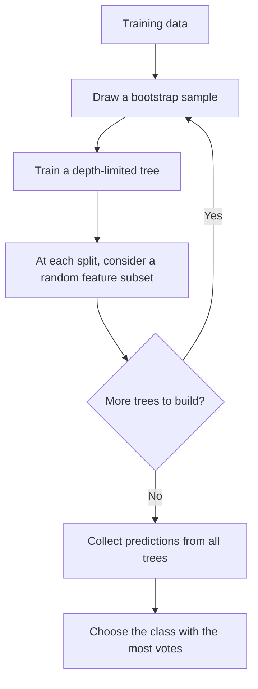

# Random Forests: Many Trees, One Vote

A **random forest** is a collection of decision trees that work together to classify examples. Each tree sees a slightly different view of the training data and considers a random subset of features when making splits. Their predictions are combined by majority vote.

The central intuition is:

> A group of diverse trees can make a more stable prediction than relying on one tree alone.

This project compares a hand-built random forest, scikit-learn's `RandomForestClassifier`, and a single decision-tree baseline on a two-class dataset. The implementation is in [`main.py`](./main.py).

## The example: two interleaving moons

The script uses scikit-learn's `make_moons` to create 300 two-feature examples with two curved classes. Noise is added so the classes are not perfectly separated. The data is split into:

- **Training set:** 70% of the examples, used to fit the models.
- **Test set:** 30%, held aside to measure predictions on examples the models did not train on.

The figure compares the hand-written forest's learned decision regions with the single-tree baseline. Dots are training examples; crosses are test examples.


The forest combines many trees, so its regions can capture more of the curved pattern. A single decision tree makes axis-aligned splits and often produces simpler, blockier regions. The forest panel can also look irregular because every tree is limited to depth 5 and the training data is noisy.

## How one forest is built

The hand-written section uses **50 trees**. Each tree is trained with two sources of randomness:

1. **Bootstrap sampling:** draw a training set of the same size as the original training set, sampling with replacement. Some examples appear more than once, and some are left out.
2. **Feature subsampling:** at each tree split, consider a random subset of features. Here, `max_features='sqrt'`; with two features, that allows one randomly selected feature to be considered at a split.



Different bootstrap samples and feature choices create trees that make different errors. Voting helps reduce dependence on any one tree's particular fit.

## Why use both bootstrap samples and random features?

- **Bootstrapping** changes which training examples a tree sees, reducing similarity between trees.
- **Feature subsampling** makes trees consider different split candidates, adding further diversity.
- **Voting** combines those diverse predictions. For a binary classification task, the class receiving more votes is selected.

In this implementation, `forest_predict()` gathers one vote per tree and returns the class with the most votes.

## Out-of-bag evaluation

Because a bootstrap sample is drawn with replacement, some training examples are omitted from a given tree's sample. Those omitted examples are **out-of-bag (OOB)** for that tree.

The hand-built implementation predicts each training example using only trees for which that example was OOB. It combines those OOB predictions and calculates OOB accuracy for examples that received at least one OOB vote.

OOB accuracy provides an internal estimate of generalization without creating another validation split. It is still an estimate—not a guarantee—and it is distinct from the test accuracy calculated on the held-out test set.

## The three models in this project

| Model | Trees | How its score is calculated |
| --- | ---: | --- |
| Hand-written forest | 50, maximum depth 5 | Bootstrap samples, random feature subsets, OOB votes, and majority-vote test predictions |
| scikit-learn random forest | 100, maximum depth 5 | `RandomForestClassifier` with bootstrap sampling, OOB scoring, and majority voting |
| Single decision tree | 1, maximum depth 5 | A baseline tree trained on the same training split |

The scikit-learn forest also reports `feature_importances_`. These are impurity-based scores that indicate how much each feature contributed to reducing split impurity across the fitted trees. They are relative model diagnostics, not proof that a feature causes the outcome.

## How to read the metrics

- **OOB accuracy:** fraction of eligible training examples correctly classified from their out-of-bag votes.
- **Test accuracy:** fraction of held-out test examples correctly classified.
- **Train accuracy (single tree):** fraction of training examples correctly classified by the baseline tree.
- **Feature importance:** the scikit-learn forest's relative impurity-based importance for each input feature.

The models use random sampling, so exact scores may vary if the randomness or configuration changes. Test accuracy is the most direct comparison here because each model is evaluated on the same held-out test split.

## How this maps to the code

| Code | Purpose |
| --- | --- |
| `make_moons(...)` | Generates two noisy, interleaving classes. |
| `train_test_split(...)` | Separates training examples from held-out test examples. |
| `bootstrap(X, y)` | Samples training examples with replacement. |
| `DecisionTreeClassifier(..., max_features='sqrt')` | Creates a depth-limited tree with feature randomness at each split. |
| `oob_votes` | Accumulates predictions from trees that did not train on a given example. |
| `forest_predict(X)` | Collects votes from all hand-built trees and selects the majority class. |
| `RandomForestClassifier(...)` | Fits scikit-learn's random forest and calculates its OOB score. |
| `DecisionTreeClassifier(...)` | Provides the single-tree baseline. |

## Run it

The script uses NumPy and scikit-learn. Install them with:

```powershell
python -m pip install numpy scikit-learn
```

Then run from this folder:

```powershell
python main.py
```

## Limitations

- A random forest is less interpretable than a single small decision tree.
- The result depends on choices such as tree count, depth, and feature-subsampling strategy.
- OOB and test scores are estimates based on finite samples; different data splits can produce different metrics.
- The demonstration uses a small synthetic dataset, not a real-world evaluation.
- Feature importance can be misleading for correlated features and should not be interpreted as causal importance.

## In one sentence

**A random forest trains diverse decision trees on randomized views of the data and combines their votes to make a more stable classification.**

## Contact

- GitHub: [@iam-dev-Adarsh](https://github.com/iam-dev-Adarsh)
- Email: [iamvoid03@gmail.com](mailto:iamvoid03@gmail.com)